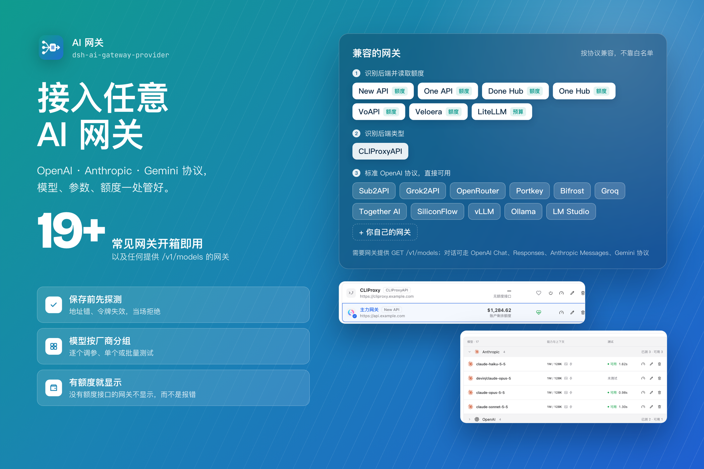
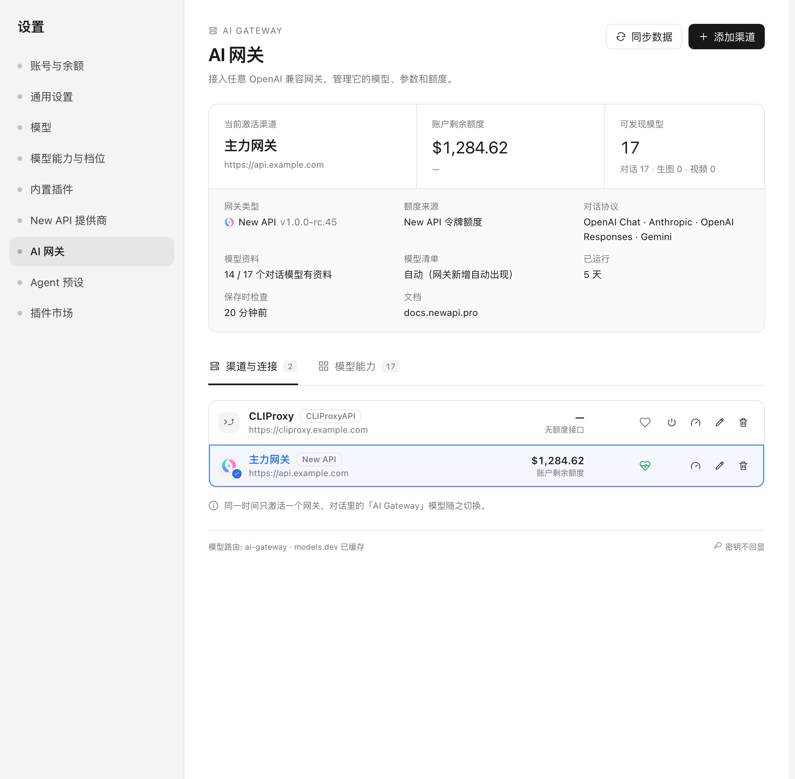
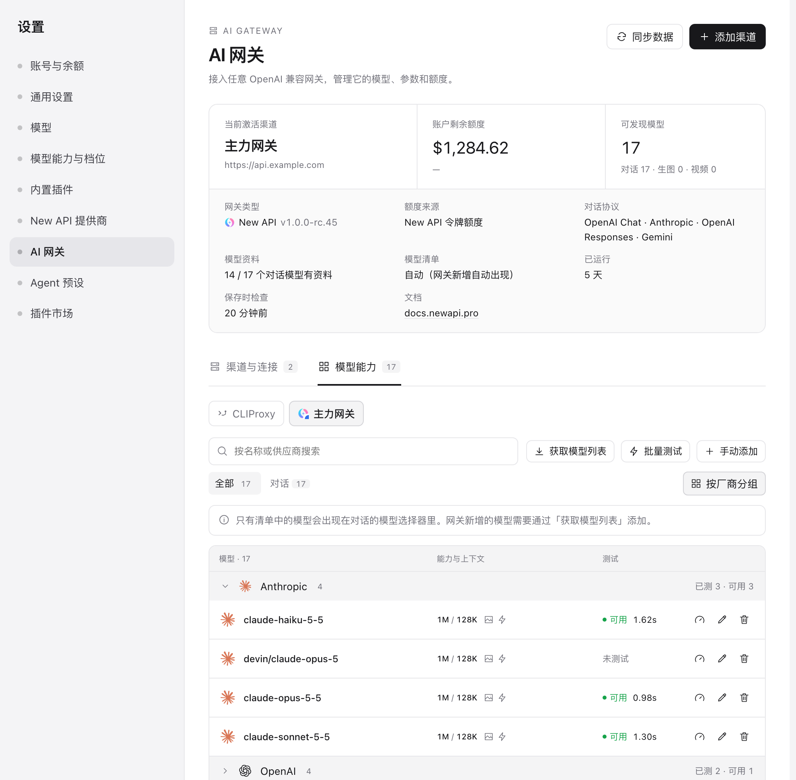
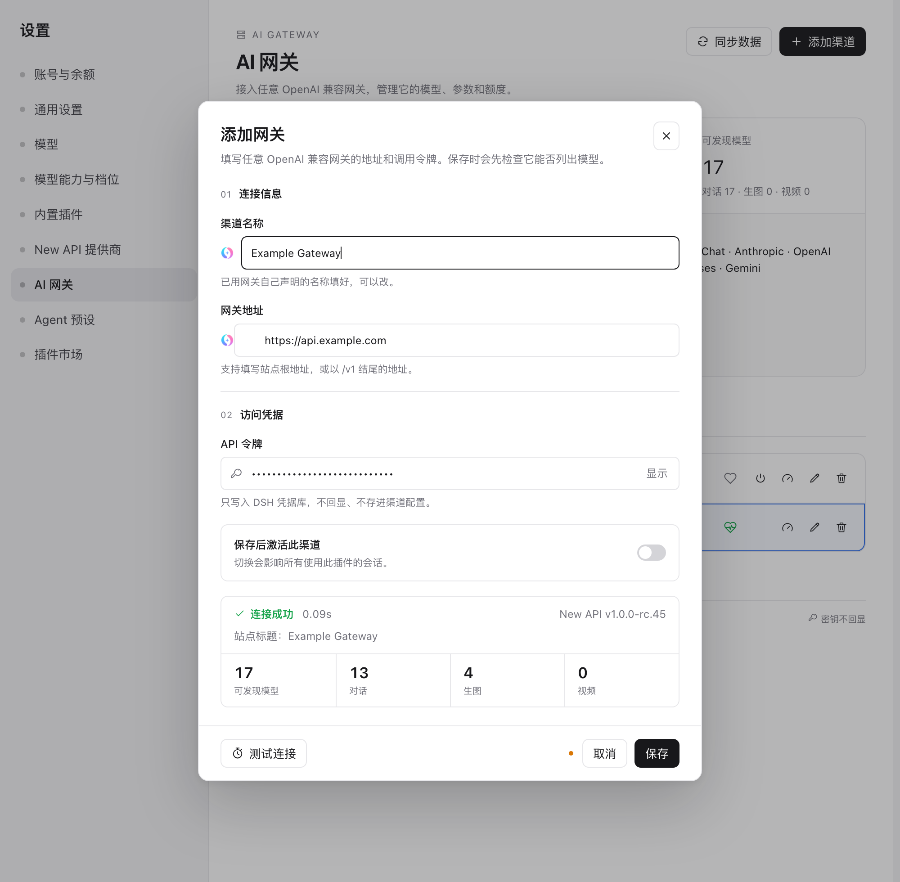

# AI 网关（DeepSeek Harness 插件）

[简体中文](https://github.com/zenVibeCoding/dsh-ai-gateway-provider/blob/master/README.zh.md) | [English](https://github.com/zenVibeCoding/dsh-ai-gateway-provider/blob/master/README.md)

[](https://www.npmjs.com/package/dsh-ai-gateway-provider)
[](LICENSE)

把**任意 AI 网关**接进 DeepSeek Harness——对话可走 OpenAI、Anthropic、Gemini 协议，模型、参数、额度一处管好。



这类项目本质上是同样的三个接口，只是名字不同。所以这个插件不去维护一份厂商清单，而是按协议来：只要它说 `/v1/models` 和 `/v1/chat/completions`，就能用——包括一个还没人听过的新网关。



## 安装

```sh
# DeepSeek Harness → 设置 → 内置插件 → 按包名安装
dsh-ai-gateway-provider
```

需要 DSH ≥ 0.2.1-rc.1 且 < 0.3.0。本文说明本地 **0.6.0（尚未发布）** 功能；npm `latest` 为 **0.5.2**。现有截图仅作说明，可能早于新增档位编辑器和会话控件，不代表新版 UI 已完成截图。

## 它做什么

- **先探测再保存。** 只有用你填的地址和令牌成功列出模型，网关才会被写入配置；地址错了、令牌被吊销了，当场就拒绝，不会等到第一条消息才失败。
- **按网关管理模型。** 拉取网关的模型清单、添加它没有列出的模型、逐个改名称/上游映射/上下文/输出上限/输入能力/推理等级/协议，也能隐藏不想要的。
- **模型按厂商分组。** `devin/claude-opus-5` 和 `claude-opus-5-5` 会归到 Anthropic 一组，组头显示「已测 N · 可用 M」；分组可折叠，也可以整体关掉。
- **隐藏模型。** 单个模型或整组厂商都可以从对话选择器里隐藏，不删除；隐藏的模型留在列表原位、显示为置灰，再点一次即可取消隐藏。隐藏不会把自动模式的网关变成固定清单。
- **模型测试。** 单个或批量：每次一个极短请求，输出有上限，错误会分类（无可用渠道、令牌无效、限流、超时）。
- **有额度就显示，没有就不显示。** New API、LiteLLM、one-api 系会报告额度；其它网关直接不显示额度，而不是显示成错误。
- **网关自己的身份。** 渠道图标优先用站点自己的 favicon，名称用站点声明的名字（页面标题 → 后端自报名称），并显示版本、对话协议和公开信息；识别不出类型时用中性图标。



## 支持的后端

插件并不需要认识厂商——识别只决定图标和用哪个额度接口。

| 后端 | 识别依据 | 额度 |
| --- | --- | --- |
| New API / one-api / done-hub / one-hub / Veloera / VoAPI | `GET /api/status`（`system_name`、`quota_per_unit`） | `GET /api/usage/token/` |
| LiteLLM | `GET /key/info` 有应答 | 密钥预算（`spend` / `max_budget`） |
| CLIProxyAPI | `GET /` 返回 `CLI Proxy API Server` | 无 |
| 其它任何 OpenAI 兼容网关 | `GET /v1/models` 有应答 | 无 |

每个模型的协议：OpenAI Chat Completions、OpenAI Responses、Anthropic Messages、Gemini。由网关的 `supported_endpoint_types` 决定，模型编辑器里可以覆盖。

## 模型能力与开关

获取模型列表时，同时解析逐模型的推理等级和速度档位。推理优先使用手动映射，其次是网关的 `supported_reasoning_levels` / `default_reasoning_level`，再回退到 pi-ai 内置目录或模型系列资料；这些 fallback 是模型资料，**不是网关声明**，未识别的支持情况仍为未知。速度声明只采纳逐模型的 `service_tiers` / `supported_service_tiers`；目录发现不自动发付费模型探测。

点击模型行的铅笔，可以独立启用推理等级和速度档位，通过行编辑表添加、删除允许在对话中出现的档位，并编辑对应 API 参数值。关闭速度会隐藏会话按钮并完全省略 `service_tier`，旧会话选择也不能绕过；关闭推理等级选择后不再提供等级菜单。自动识别资料保留，重新开启时可继续使用。

## GPT / OpenAI 速度档位

速度表每行包含本地档位名与发送给网关的 `service_tier` 值。预设为 Standard → `default`、Fast → `priority`、Ultrafast → `ultrafast`；可以修改参数值，或选择「自定义档位」并填写例如 `turbo` → `vendor-priority`。添加按钮在没有更多已识别档位时直接新增自定义行。配置以 `allowedServiceTiers` 和 `serviceTierMap` 按网关及模型保存，只有 OpenAI Chat / Responses 请求发送映射后的值。没有默认速度下拉框，具体档位在对话里选择。

[OpenAI Fast mode 官方说明](https://developers.openai.com/api/docs/guides/fast-mode) 将 `fast` 与 `priority` 作为等价请求写法；插件比较声明与响应回显时将 `fast` 归一为 `priority`。[Ultrafast 官方说明](https://developers.openai.com/api/docs/guides/ultrafast-mode) 有支持模型及可用性限制：编辑器提供该预设，不代表每个模型、账号或网关都可用。

**对话里切换**：当前模型是 AI Gateway 的 GPT 模型、速度开关开启，且有网关声明、响应回显证据或显式手动配置时，输入框右下、模型按钮左边会出现「⚡ 速度」按钮，可为**当前会话**选择预设或自定义速度档位，菜单里标明每个档位的依据。这里的选择只对当前会话的这个模型生效，不改模型默认值；没选过的会话保留原有模型配置，不会仅因添加自定义行就自动切换到该档位。（DSH 的模型菜单没有给插件留扩展行，所以放在它旁边。）

**怎么判断一个模型支不支持**——按「这个网关 + 这个模型」判断，三种证据分开记：

| 证据 | 来源 | 页面显示 |
| --- | --- | --- |
| 网关声明 | 网关模型目录里逐模型的 `service_tiers` / `supported_service_tiers`（CLIProxyAPI 在 `/v1/models?client_version=` 返回） | 编辑器里列出声明的档位，选项标「网关声明」 |
| 响应回显 | 点「测试」，带上该档位发一次极短请求，读取返回的 `service_tier` | ✓ 回显匹配（UI 标「已生效」）/ ↓ 回显其他档位 / ? 未回显 |
| 手动配置 | 显式添加本地档位和参数映射；未被网关声明或当前映射的测试回显证实 | 对话菜单标「手动配置」，提示中显示实际 `service_tier` 值 |

速度能力按具体网关、上游模型和实际选用的 OpenAI Chat / Responses 协议判断。GPT 名称只限制此功能的适用范围；模型名、网关品牌、models.dev 都不证明速度支持。显式空列表表示「未声明加速档位」，缺少资料则为未知。标签只描述声明、响应回显或手动配置，**响应回显本身不独立证明上游实际加速**；耗时变短也不构成证明。

**各网关的情况**：
- **CLIProxyAPI**：会在客户端模型目录里声明（Codex 渠道的 GPT 模型通常声明 Fast）。
- **New API**：部署可能过滤 `service_tier`，需检查渠道是否允许透传；回显不同或缺失，本身并不能定位过滤发生在哪一层。
- **其他网关**：仍可走通用 OpenAI 兼容路径。缺少档位声明保持未知；手动映射是可选尝试，不代表已检测到支持。

加速档位可能额外计费。连接探测和目录读取不调用模型，也没有自动付费探测；用户主动点击**模型测试**（含批量）或发送**聊天**会调用模型，可能产生费用。Anthropic / Gemini 的速度模式不在这次支持范围内。

## 添加网关



1. 设置 → AI 网关 → **添加渠道**。
2. 填地址和令牌，点 **测试连接**。
3. 名称会自动填成网关自己声明的名字（只在你没填过时），地址栏显示它的 favicon，检查结果里给出模型数量。
4. 保存。这个网关的模型会出现在对话的模型选择器里，名字是 **AI Gateway**。

同一时间只激活一个网关，切换会影响所有使用此插件的会话。令牌只写进 DSH 凭据库——不进配置、不回显、不返回给页面。

## 隐私与安全

- 探测只发只读 `GET`，**不调用模型、不产生费用**。
- 不跟随重定向，令牌不会被转发到其它主机。
- 站点图标只从网关自己的域名取，有大小上限，磁盘缓存 24 小时。
- 识别只用公开接口，只存公开信息（类型、版本、标题、图标）——没有令牌，也没有用户数据。
- 没有额度接口的网关就报「没有」，不会显示成错误。

## 限制

- **不包含生图和视频工具**：`dsh-newapi-provider` 里的生成工具依赖 New API 自己的任务接口。这里会列出网关的生图模型，但不会驱动它们。
- 额度适配只覆盖上面三类。其它方式暴露额度的后端，在补适配器之前不显示额度。
- 网关识别是启发式的；把所有公开接口都藏起来的网关会被当作普通 OpenAI 兼容端点处理——这仍然足够使用。

## 开发

```sh
npm test                                    # 141 项测试，基于本地假网关
node scripts/probe.mjs --base <url>         # 命令行探测
GATEWAY_KEY=sk-... node scripts/probe.mjs --base <url>
```

## 许可证

MIT
